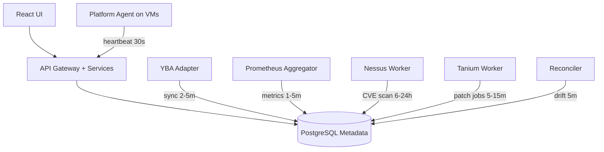
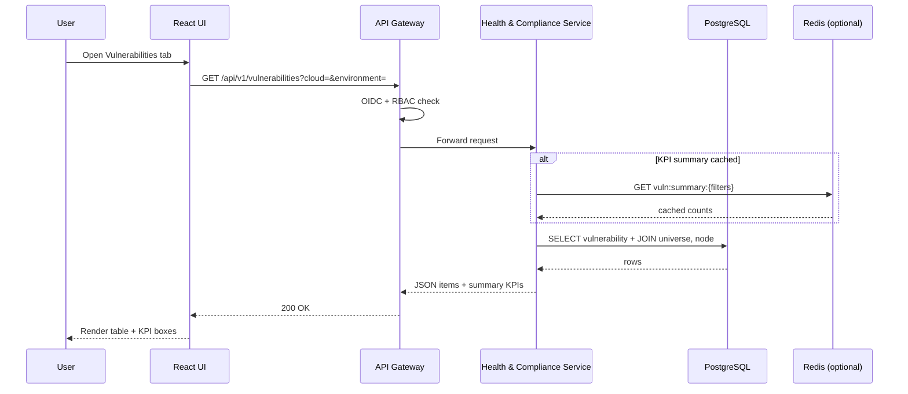
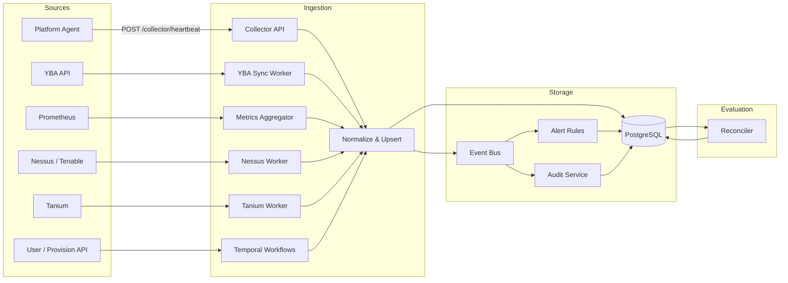
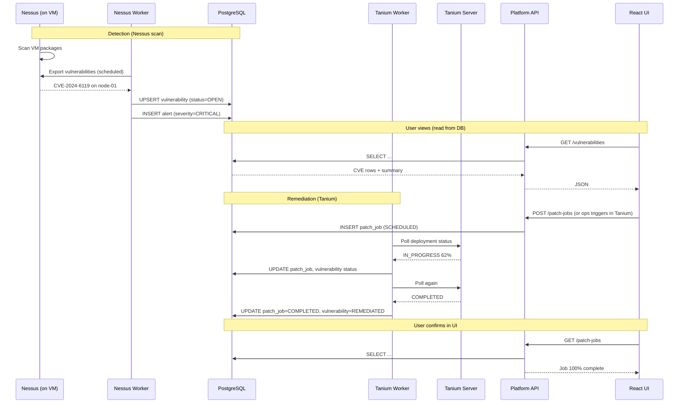
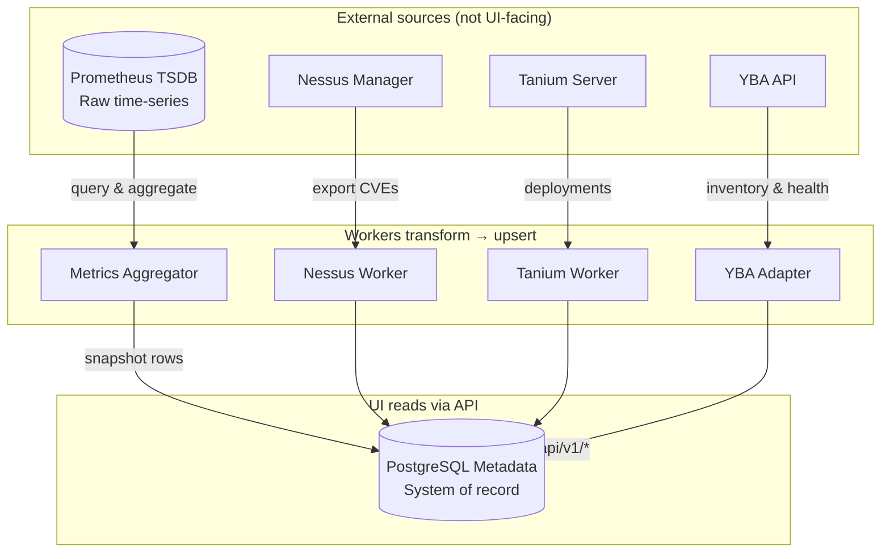
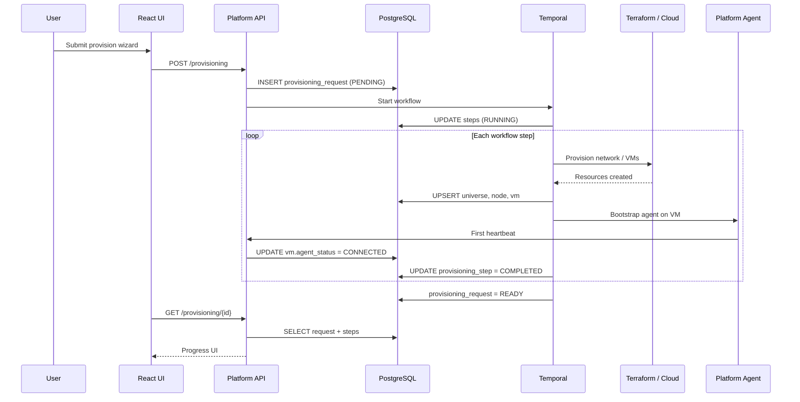

# YugabyteDB Platform — Backend Design

**Document Version:** 1.0  
**Status:** Draft — aligns UI demo with target backend  
**Last Updated:** August 27, 2026

---

## 1. Purpose

This document defines how the **backend control plane** populates the Operations Console UI. It maps every current demo screen to:

- REST APIs the frontend will call
- Metadata tables that store current state
- External systems that feed those tables (agents, Nessus, Tanium, YBA, Prometheus)
- Event flows that keep data fresh

**Principle:** The UI reads **aggregated current state** from the platform API. It never calls Nessus, Tanium, AWS, or YBA directly.

---

## 2. Architecture Diagram

High-level control plane — how the UI, API, database, and data sources connect:



### Is everything stored in the database?

**Yes — for everything the UI displays as current state.**

| Question | Answer |
|----------|--------|
| Does the UI read from the database? | **Yes.** UI → REST API → PostgreSQL (via service layer). |
| Do workers write to the database? | **Yes.** Agents, YBA, Nessus, Tanium, Prometheus aggregator, and reconciler all **upsert** normalized rows. |
| Does the UI ever call Nessus/Tanium/YBA directly? | **No.** External tools are integrated only by backend workers. |
| Is PostgreSQL the only store? | **For inventory, health, compliance, alerts, CVEs, patches, drift, certs, and audit — yes.** Time-series metrics may also exist in **Prometheus** (source), but the UI reads **snapshots** from PostgreSQL (`universe_metrics_snapshot`). Raw Nessus/Tanium payloads are not kept long-term. |

**Mental model:** PostgreSQL is the **system of record** for “what the platform knows right now.” Workers keep it fresh; the API serves it; the UI renders it.

---

## 3. End-to-End Data Flow

### 3.1 Read path (UI loads a screen)

What happens when a user opens **Agents & Alerts → Vulnerabilities**:



**Every UI tab follows the same pattern:** HTTP GET → authorized service → SQL query (often with filters) → JSON shaped like today’s `demoData.js`.

| UI screen | Primary tables read |
|-----------|---------------------|
| Overview KPIs | `universe`, `node`, `vm`, `certificate`, `alert` (aggregated) |
| Universe list | `universe` + `environment` + `cloud` |
| Universe detail | `universe`, `universe_health_dimension`, `universe_issue`, `universe_metrics_snapshot` |
| Node / VM drill-down | `node`, `vm`, `component` |
| VMs flat list | `vm` JOIN `node` JOIN `universe` |
| Alerts | `alert` WHERE status = ACTIVE |
| Drift | `drift_item` |
| Vulnerabilities | `vulnerability` |
| Patching | `patch_job` |
| Certificates | `certificate` |
| Audit | `audit_log` |
| Platform Health | `platform_health_check` (control-plane probes, separate from YB estate) |

---

### 3.2 Write path (data enters the platform)

How external reality becomes rows in PostgreSQL:



Step-by-step for each source:

| Step | Source | Action | Tables updated |
|------|--------|--------|----------------|
| 1 | **Platform Agent** (every 30s) | Sends heartbeat with VM agents, YB processes, CPU/mem/disk | `vm`, `component`, `node` status |
| 2 | **Collector API** | Validates mTLS, writes via Inventory Service | Same as above |
| 3 | **Health Service** | Evaluates heartbeat rules | `alert`, `universe_health_dimension`, `universe_issue` |
| 4 | **YBA Adapter** (2–5 min) | Polls universes, nodes, YBA health | `universe`, `node`, `universe_health_dimension` |
| 5 | **Prometheus Aggregator** (1–5 min) | Queries YB metrics, aggregates per universe | `universe_metrics_snapshot` |
| 6 | **Nessus Worker** (6–24 hr) | Exports CVEs, maps to VMs by instance ID / tag | `vulnerability` |
| 7 | **Tanium Worker** (5–15 min) | Syncs patch deployments | `patch_job`, links to `vulnerability.patch_job_id` |
| 8 | **Cert Scanner** (daily) | Reads certs from agent + PKI | `certificate` |
| 9 | **Reconciler** (5 min) | Compares desired vs actual | `drift_item` |
| 10 | **User provision** | POST `/provisioning` starts Temporal workflow | `provisioning_request`, `provisioning_step`, then inventory tables as resources are created |
| 11 | **All mutations** | API actions + worker completions | `audit_log` (append-only) |

---

### 3.3 Full lifecycle example: CVE → patch → UI

End-to-end flow for a vulnerability the user sees in the demo:



---

### 3.4 Data store roles (what lives where)



| Store | Role | UI access? |
|-------|------|------------|
| **PostgreSQL** | Current inventory, health, alerts, CVEs, patches, drift, certs, audit, metric **snapshots** | **Yes** (only path) |
| **Prometheus** | Raw YB/infra time-series; source for aggregators | No (future: deep-dive charts API) |
| **Redis** | Optional cache for overview KPIs / list summaries | No |
| **Kafka / Event Bus** | Events between services; not queried by UI | No |
| **Temporal** | Workflow state for provisioning/patching | Indirect via `provisioning_request` in PostgreSQL |
| **Nessus / Tanium / YBA** | External systems of record for scans/patches/YB config | No — workers sync in |

---

### 3.5 Provision universe flow (write + read)



---

## 4. Target Architecture (Service Layer)

```
┌─────────────────────────────────────────────────────────────────────────┐
│                         React Operations UI                              │
│  Overview │ Universes │ Agents & Alerts │ Provision │ Platform Health   │
└───────────────────────────────┬─────────────────────────────────────────┘
                                │ HTTPS / REST  /api/v1
┌───────────────────────────────▼─────────────────────────────────────────┐
│                           API Gateway                                    │
│              OIDC auth │ RBAC │ rate limits │ request audit              │
└───────────────────────────────┬─────────────────────────────────────────┘
                                │
     ┌──────────────────────────┼──────────────────────────┐
     │                          │                          │
┌────▼─────┐  ┌────────────────▼────────────┐  ┌─────────▼──────────┐
│ Inventory│  │ Health & Compliance Service │  │ Lifecycle Service  │
│ Service  │  │                             │  │ (Temporal)         │
└────┬─────┘  └──────────────┬──────────────┘  └─────────┬──────────┘
     │                         │                           │
     └─────────────────────────┼───────────────────────────┘
                               │
                    ┌──────────▼──────────┐
                    │   Metadata Store    │
                    │   (PostgreSQL)      │
                    └──────────┬──────────┘
                               │
     ┌─────────────────────────┼─────────────────────────┐
     │                         │                         │
┌────▼─────┐  ┌────────────────▼──────────┐  ┌──────────▼─────────┐
│ Ingestion│  │ Metrics Aggregator        │  │ Reconciler Worker  │
│ Workers  │  │ (Prometheus / YBA)        │  │ (desired vs actual)│
└────┬─────┘  └──────────────┬────────────┘  └──────────┬─────────┘
     │                         │                         │
┌────▼─────────────────────────▼─────────────────────────▼────────────┐
│ Platform Agent │ YBA Adapter │ Nessus/Tenable │ Tanium │ Cloud APIs   │
└───────────────────────────────────────────────────────────────────────┘
```

### Service responsibilities

| Service | Owns |
|---------|------|
| **Inventory Service** | Clouds, environments, universes, nodes, VMs, component catalog |
| **Health & Compliance Service** | Health dimensions, alerts, drift, certificates, CVEs, patch jobs, overview KPIs |
| **Lifecycle Service** | Provisioning workflows, remediate/scale/upgrade actions |
| **Ingestion Workers** | Poll/sync external tools → normalize → upsert metadata |
| **Metrics Aggregator** | Pull Prometheus/YBA metrics → universe_metrics snapshot table |
| **Reconciler** | Compare `desired_state` vs `actual_state` → drift records |
| **Audit Service** | Append-only audit log from all mutating APIs and workers |

---

## 5. UI → API Mapping

Each frontend view maps to one primary API module. Replace `demoData.js` imports with a thin `apiClient` layer.

| UI Tab / Sub-view | Demo data today | Backend API(s) |
|-------------------|-----------------|----------------|
| **Overview** KPIs | `GLOBAL_KPIS`, `GLOBAL_OVERVIEW` | `GET /overview/kpis`, `GET /overview/matrix` |
| **Overview** critical issues | `CRITICAL_ISSUES` | `GET /overview/issues?limit=20` |
| **Universes** inventory | `UNIVERSES`, filters | `GET /universes?cloud=&environment=` |
| **Universes** detail | `getUniverseById`, health grid | `GET /universes/{id}`, `GET /universes/{id}/health` |
| **Universes** metrics | `UNIVERSE_METRICS` | `GET /universes/{id}/metrics` |
| **Universes** nodes | `NODES`, node detail | `GET /universes/{id}/nodes`, `GET /nodes/{id}` |
| **VMs** flat list | `INFRASTRUCTURE` | `GET /vms?cloud=&environment=&agentStatus=` |
| **Alerts** | `ALERTS` | `GET /alerts?severity=&status=ACTIVE` |
| **Drift** | `DRIFT_ITEMS` | `GET /drift?cloud=&environment=` |
| **Vulnerabilities** | `VULNERABILITIES` | `GET /vulnerabilities?cloud=&environment=&severity=&status=` |
| **Patching** | `PATCH_JOBS` | `GET /patch-jobs?cloud=&environment=&status=` |
| **VM Agents** | agent rows in components | `GET /vm-agents?cloud=&environment=` |
| **Certificates** | `CERTIFICATES` | `GET /certificates?cloud=&environment=` |
| **Provision wizard** | `PROVISION_STEPS`, form enums | `POST /provisioning`, `GET /provisioning/{id}` |
| **Platform Health** | `PLATFORM_HEALTH` | `GET /platform/health` |
| **Audit** | `AUDIT_LOG` | `GET /audit?from=&to=` |

### Shared query parameters (all list endpoints)

| Param | Type | Description |
|-------|------|-------------|
| `cloud` | `AWS` \| `Azure` | Filter by cloud provider |
| `environment` | `DEV` \| `IT` \| `UAT` \| `PROD` | Filter by environment |
| `page` | int | Pagination (default 0) |
| `size` | int | Page size (default 50) |

---

## 6. Extended Metadata Model

Extend [TECHNICAL_SPECIFICATION.md](./TECHNICAL_SPECIFICATION.md) with tables for features added in the UI demo.

### 6.1 `universe_health_dimension`

Stores the 8-tile health grid per universe.

| Column | Type | Description |
|--------|------|-------------|
| id | UUID | PK |
| universe_id | UUID | FK → universe |
| dimension | ENUM | infrastructure, yugabytedb, yba, security, certificates, monitoring, backup, compliance |
| status | ENUM | HEALTHY, WARNING, CRITICAL, UNKNOWN |
| message | TEXT | Optional detail |
| evaluated_at | TIMESTAMPTZ | Last evaluation |

### 6.2 `universe_issue`

Active issues shown on universe detail and overview feed.

| Column | Type | Description |
|--------|------|-------------|
| id | UUID | PK |
| universe_id | UUID | FK |
| node_id | UUID | Nullable FK |
| severity | ENUM | |
| message | TEXT | |
| source | VARCHAR | health_check, nessus, cert_scan, drift |
| status | ENUM | OPEN, ACKNOWLEDGED, RESOLVED |
| created_at | TIMESTAMPTZ | |
| resolved_at | TIMESTAMPTZ | |

### 6.3 `universe_metrics_snapshot`

Latest aggregated metrics per universe (maps to `UNIVERSE_METRICS` in demo).

| Column | Type | Description |
|--------|------|-------------|
| universe_id | UUID | PK |
| read_ops_per_sec | NUMERIC | |
| write_ops_per_sec | NUMERIC | |
| avg_read_latency_ms | NUMERIC | |
| avg_write_latency_ms | NUMERIC | |
| active_connections | INT | |
| tablets_total | INT | |
| tablets_unhealthy | INT | |
| under_replicated | INT | |
| leaderless_tablets | INT | |
| cpu_avg_pct | NUMERIC | Node average |
| memory_avg_pct | NUMERIC | |
| disk_used_pct | NUMERIC | |
| replication_lag_ms | NUMERIC | |
| collected_at | TIMESTAMPTZ | |

**Source:** Prometheus queries (YB metrics) + platform agent resource samples, refreshed every 1–5 minutes.

### 6.4 `vm_agent_definition`

Expected agents per cloud (maps to `VM_AGENT_DEFINITIONS`).

| Column | Type | Description |
|--------|------|-------------|
| id | UUID | PK |
| cloud_provider | ENUM | AWS, AZURE |
| agent_type | VARCHAR | AZURE_MONITOR_AGENT, CLOUDWATCH_AGENT, etc. |
| label | VARCHAR | Display name |
| service_name | VARCHAR | OS service name |
| required | BOOLEAN | Compliance requirement |

### 6.5 `component` (extended)

Each VM agent, YB process, and platform agent is a row in `component` (already in tech spec). Agent heartbeat from Platform Agent upserts rows:

| component_type | Source |
|----------------|--------|
| PLATFORM_AGENT | Platform Agent heartbeat |
| YB_MASTER, YB_TSERVER | Platform Agent + YBA |
| AZURE_MONITOR_AGENT, CLOUDWATCH_AGENT, TANIUM_CLIENT, NESSUS_AGENT, DD_AGENT | Platform Agent local checks or ingestion worker |

### 6.6 `alert`

| Column | Type | Description |
|--------|------|-------------|
| id | UUID | PK |
| severity | ENUM | |
| title | VARCHAR | |
| resource_label | VARCHAR | e.g. `payments-prod / node-02` |
| message | TEXT | |
| universe_id | UUID | Nullable |
| node_id | UUID | Nullable |
| status | ENUM | ACTIVE, ACKNOWLEDGED, RESOLVED |
| created_at | TIMESTAMPTZ | |

**Created by:** Health evaluation rules, cert expiry rules, Nessus critical findings, agent disconnect events.

### 6.7 `drift_item`

| Column | Type | Description |
|--------|------|-------------|
| id | UUID | PK |
| resource_label | VARCHAR | |
| component | VARCHAR | |
| desired | VARCHAR | |
| actual | VARCHAR | |
| universe_id | UUID | |
| detected_at | TIMESTAMPTZ | |
| status | ENUM | OPEN, REMEDIATED, IGNORED |

**Source:** Reconciler comparing metadata desired_state vs agent-reported actual_state.

### 6.8 `vulnerability` (CVE)

| Column | Type | Description |
|--------|------|-------------|
| id | UUID | PK |
| cve_id | VARCHAR | e.g. CVE-2024-6119 |
| severity | ENUM | CRITICAL, WARNING |
| title | TEXT | |
| package_name | VARCHAR | |
| installed_version | VARCHAR | |
| fixed_version | VARCHAR | |
| cloud | ENUM | |
| environment | ENUM | |
| universe_id | UUID | |
| node_id | UUID | |
| vm_id | UUID | |
| status | ENUM | OPEN, SCHEDULED, IN_PROGRESS, REMEDIATED |
| source | VARCHAR | Nessus |
| first_seen | TIMESTAMPTZ | |
| last_seen | TIMESTAMPTZ | |
| patch_job_id | UUID | Nullable FK → patch_job |

### 6.9 `patch_job`

| Column | Type | Description |
|--------|------|-------------|
| id | UUID | PK |
| title | VARCHAR | |
| cve_ids | TEXT[] | Linked CVE IDs |
| universe_id | UUID | |
| node_ids | UUID[] | Target nodes |
| tool | VARCHAR | Tanium |
| status | ENUM | SCHEDULED, IN_PROGRESS, COMPLETED, FAILED |
| scheduled_for | TIMESTAMPTZ | |
| started_at | TIMESTAMPTZ | |
| completed_at | TIMESTAMPTZ | |
| owner | VARCHAR | Team |
| maintenance_window | VARCHAR | |
| progress_pct | INT | 0–100 |
| failure_reason | TEXT | |
| external_job_id | VARCHAR | Tanium deployment ID |

---

## 7. Data Ingestion Pipelines

### 7.1 Platform Agent (every 30s)

**Direction:** VM → Platform (outbound HTTPS/mTLS)

```json
POST /api/v1/agent/heartbeat
{
  "nodeId": "uuid",
  "universeId": "uuid",
  "timestamp": "2026-08-27T22:00:00Z",
  "platformAgent": { "version": "1.2.0", "status": "HEALTHY" },
  "vmAgents": [
    { "type": "NESSUS_AGENT", "status": "HEALTHY", "version": "10.7.2", "message": "Running" },
    { "type": "TANIUM_CLIENT", "status": "HEALTHY", "version": "7.4.10.1083", "message": "Connected" }
  ],
  "ybProcesses": [
    { "type": "YB_MASTER", "status": "HEALTHY", "version": "2.25.1.0" },
    { "type": "YB_TSERVER", "status": "HEALTHY", "version": "2.25.1.0" }
  ],
  "resources": { "cpuPct": 42, "memoryPct": 68, "diskUsedPct": 54 }
}
```

**Worker actions:**
1. Upsert `vm.agent_status`, `vm.last_heartbeat`
2. Upsert `component` rows for each reported agent/process
3. Emit `AGENT_HEARTBEAT` event → alert if disconnected > threshold

### 7.2 YBA Adapter (every 2–5 min)

Poll YBA API per registered YBA instance:

- Universe list and versions → sync `universe.yb_version`, node roles
- Universe health from YBA → feed `universe_health_dimension.yugabytedb`, `yba`
- Tablet/universe metrics → write `universe_metrics_snapshot` (or push to Prometheus first)

### 7.3 Prometheus / Metrics Aggregator (every 1–5 min)

Scheduled job queries Prometheus (or YBA metrics endpoint):

```promql
# Examples
yb_ops_read{universe="payments-prod"}
yb_ops_write{universe="payments-prod"}
yb_latency_read{universe="payments-prod"}
```

Aggregate per universe → upsert `universe_metrics_snapshot`.

Threshold evaluation (same logic as demo `getMetricStatus`) runs server-side → may create `universe_issue` or `alert`.

### 7.4 Nessus / Tenable Sync (every 6–24 hours + on-demand)

**Worker:** `NessusIngestionWorker`

1. Call Tenable.io or Nessus Manager API: export vulnerabilities filtered by VM tags/asset groups matching platform inventory
2. Match assets to `vm.cloud_instance_id` or platform-assigned asset tag
3. Upsert `vulnerability` rows; set `last_seen`
4. Mark stale findings REMEDIATED if absent from scan for N days
5. Critical new CVEs → create `alert` + optional `universe_issue`

**Do not** store raw Nessus JSON long-term; normalize to `vulnerability` table.

### 7.5 Tanium Sync (every 5–15 min)

**Worker:** `TaniumIngestionWorker`

1. Query Tanium deployments / patch jobs targeted at YB node computer groups
2. Map external deployment ID → `patch_job.external_job_id`
3. Update `patch_job.status`, `progress_pct`, `failure_reason`
4. When job completes → update linked `vulnerability.status` to REMEDIATED (after Nessus confirms on next scan)

### 7.6 Certificate Scanner (daily)

- Platform agent cert check + optional enterprise PKI inventory API
- Upsert `certificate` table; compute `days_remaining`, `status`
- Expiry < 30 days → WARNING alert; < 14 days → CRITICAL alert

### 7.7 Reconciler (continuous / every 5 min)

Compare:

| Desired (metadata) | Actual (components / agents) |
|--------------------|------------------------------|
| Agent version 7.4.10 | Reported 7.4.9 |
| Backup schedule DAILY | Last backup 26h ago |
| Security agent RUNNING | STOPPED |

Creates/updates `drift_item` rows.

---

## 8. REST API Specification (UI Contract)

Base: `/api/v1`  
Auth: Bearer token (OIDC)  
All responses include standard pagination wrapper where applicable.

### 8.1 Overview

#### `GET /overview/kpis`

```json
{
  "totalUniverses": 38,
  "totalNodes": 114,
  "healthy": 109,
  "warning": 4,
  "critical": 1,
  "agentsConnected": 112,
  "certsExpiring30d": 6
}
```

#### `GET /overview/matrix`

```json
[
  { "cloud": "AWS", "env": "PROD", "universes": 8, "nodes": 24, "healthy": 23, "warning": 0, "critical": 1 }
]
```

#### `GET /overview/issues`

Returns open `universe_issue` + critical `alert` items sorted by severity.

### 8.2 Universes

#### `GET /universes`

Query: `cloud`, `environment`, `status`

```json
{
  "items": [
    {
      "id": "uni-payments-prod",
      "name": "payments-prod",
      "cloud": "AWS",
      "environment": "PROD",
      "region": "us-east-1",
      "ybVersion": "2.25.1.0",
      "owner": "DBA Team",
      "status": "WARNING",
      "nodeCount": 3,
      "metricsStatus": "WARNING"
    }
  ],
  "total": 8,
  "summary": { "total": 38, "metricsHealthy": 6, "metricsAtRisk": 2 }
}
```

#### `GET /universes/{id}`

Full universe detail including `health` object (8 dimensions), `issues[]`, linked YBA summary.

#### `GET /universes/{id}/metrics`

Returns `universe_metrics_snapshot` row (same shape as demo `UNIVERSE_METRICS`).

#### `GET /universes/{id}/nodes`

Node list with status; used in universe detail table.

#### `GET /nodes/{id}`

Node detail with `components[]` grouped by category (YUGABYTE, PLATFORM, VM_AGENT) — powers VM drill-down.

### 8.3 VMs (flat inventory)

#### `GET /vms`

Query: `cloud`, `environment`, `agentStatus` (CONNECTED | DISCONNECTED)

```json
{
  "items": [
    {
      "id": "node-payments-prod-01",
      "name": "node-01",
      "cloud": "AWS",
      "environment": "PROD",
      "universe": "payments-prod",
      "universeId": "uni-payments-prod",
      "agentStatus": "CONNECTED",
      "vmAgentsSummary": "4/4",
      "vmAgents": [
        { "type": "CLOUDWATCH_AGENT", "status": "HEALTHY" }
      ],
      "vm": { "instanceId": "i-abc123", "os": "RHEL 8.8", "type": "m5.2xlarge" },
      "status": "HEALTHY"
    }
  ],
  "summary": { "total": 24, "connected": 24, "disconnected": 0 }
}
```

### 8.4 Agents & Alerts

#### `GET /alerts`

Query: `severity`, `status=ACTIVE`

#### `GET /drift`

#### `GET /vulnerabilities`

Query: `cloud`, `environment`, `severity`, `status`  
Response includes `summary: { total, critical, open, remediated }` for KPI row.

#### `GET /patch-jobs`

Query: `cloud`, `environment`, `status`  
Response includes `summary: { scheduled, inProgress, completed, failed, total }`.

#### `GET /certificates`

#### `GET /vm-agents`

Cross-estate agent health matrix (Tanium, Nessus, Monitor, Datadog columns).

### 8.5 Provisioning

Existing spec endpoints; response `steps[]` maps to `PROVISION_STEPS` in UI.

### 8.6 Platform admin

#### `GET /platform/health`

Control-plane component status (API, Temporal, Metadata DB, adapters).

#### `GET /audit`

Paginated audit log.

---

## 9. Event Model

Kafka / Service Bus topics:

| Topic | Producers | Consumers |
|-------|-----------|-----------|
| `platform.agent.heartbeat` | Agent gateway | Inventory, Health, Audit |
| `platform.health.evaluated` | Health service | Alert, Overview cache |
| `platform.vulnerability.detected` | Nessus worker | Alert, Vulnerability API |
| `platform.patch.updated` | Tanium worker | Patch API, Vulnerability status |
| `platform.drift.detected` | Reconciler | Drift API, Alert |
| `platform.provision.step` | Temporal | Provision API, Audit |
| `platform.audit` | All services | Audit store |

Events drive **real-time UI refresh** (optional Phase 2): WebSocket `/api/v1/stream` or SSE for alert count changes.

---

## 10. Frontend Integration Plan

### Phase A — API client swap (no UI rewrite)

1. Add `frontend/src/services/apiClient.js`:

```javascript
const BASE = import.meta.env.VITE_API_BASE || '/api/v1'

export async function fetchUniverses(params) {
  const q = new URLSearchParams(params)
  const res = await fetch(`${BASE}/universes?${q}`)
  if (!res.ok) throw new Error(await res.text())
  return res.json()
}
```

2. Add `frontend/src/services/dataService.js` — same function signatures as `demoData.js` helpers but calls API when `VITE_USE_MOCK=false`.

3. Replace imports in components: `from '../services/dataService'` instead of `demoData`.

### Phase B — Backend MVP

Implement in order:

| Sprint | Deliverable | Unblocks UI tab |
|--------|-------------|-----------------|
| 1 | PostgreSQL schema + Inventory Service + `GET /universes`, `/nodes`, `/vms` | Universes |
| 2 | Agent heartbeat endpoint + component upsert | VMs, VM Agents |
| 3 | Health dimensions + alerts + overview KPIs | Overview, Alerts |
| 4 | Certificate scanner + `GET /certificates` | Certificates |
| 5 | Nessus worker + `GET /vulnerabilities` | Vulnerabilities |
| 6 | Tanium worker + `GET /patch-jobs` | Patching |
| 7 | Prometheus aggregator + universe metrics | Universe metrics KPIs |
| 8 | Temporal provisioning + audit | Provision, Audit |
| 9 | Reconciler + drift | Drift |
| 10 | Platform health probes | Platform Health |

---

## 11. Recommended Backend Stack (MVP)

| Component | Recommendation | Notes |
|-----------|----------------|-------|
| API | **Go** (chi/fiber) or **Java Spring Boot** | Match enterprise standards |
| DB | **PostgreSQL 15+** | Metadata; consider YugabyteDB YSQL for dogfooding |
| Migrations | Flyway / golang-migrate | Versioned schema |
| Workflow | **Temporal** | Provisioning, patch orchestration |
| Cache | Redis | Overview KPI cache (60s TTL) |
| Auth | OIDC (Entra ID) | JWT at gateway |
| Agent ingress | Dedicated **Collector API** | High-volume heartbeats separated from UI API |
| Nessus/Tanium | Scheduled **workers** (K8s CronJob or Temporal schedules) | Rate-limit external APIs |

### Suggested repo layout

```
backend/
├── api/                 # REST handlers (UI-facing)
├── collector/           # Agent heartbeat ingress
├── workers/
│   ├── nessus-sync/
│   ├── tanium-sync/
│   ├── metrics-aggregator/
│   ├── cert-scanner/
│   └── reconciler/
├── internal/
│   ├── domain/          # Entities
│   ├── store/           # PostgreSQL repositories
│   └── adapters/        # YBA, AWS, Azure clients
├── migrations/
└── openapi/
    └── platform-v1.yaml
```

---

## 12. Security & RBAC (API layer)

Map UI role preview to API scopes:

| Role | Allowed endpoints |
|------|-------------------|
| Developer | `GET /universes`, `POST /provisioning` (DEV/UAT only) |
| Operations | Inventory read, alerts, drift, VMs, remediate actions |
| Security | Vulnerabilities, patch-jobs, certificates, vm-agents |
| DBA | Full inventory + provision + remediate |
| Admin | All + `/platform/*`, `/audit`, approve PROD provision |

Enforce `environment` in JWT claims or policy engine — e.g. Developer cannot `GET /vulnerabilities?environment=PROD` if policy denies.

---

## 13. OpenAPI & Mock Server (next step)

Generate `openapi/platform-v1.yaml` from Section 6 and run **Prism** or **WireMock** so the frontend can develop against contract before workers exist:

```bash
# Example
npx @stoplight/prism-cli mock openapi/platform-v1.yaml -p 8080
# VITE_API_BASE=http://localhost:8080/api/v1
```

---

## 14. Summary

| Data in UI | Authoritative source | Refresh cadence |
|------------|---------------------|-----------------|
| Universe inventory | Metadata DB (YBA sync) | 2–5 min |
| Health 8-tile grid | Health service evaluation | 1–5 min |
| VM agents | Platform Agent heartbeat | 30 sec |
| Universe metrics | Prometheus / YBA aggregator | 1–5 min |
| CVEs | Nessus ingestion | 6–24 hr |
| Patch jobs | Tanium ingestion | 5–15 min |
| Drift | Reconciler | 5 min |
| Certificates | Cert scanner | Daily |
| Alerts | Event-driven rules | Real-time |
| Audit | All mutating operations | Real-time |

The backend is a **control plane metadata hub** — not a replacement for Nessus, Tanium, or Prometheus. It **normalizes, correlates, and serves** their signals to the UI through a single API.

**Recommended next action:** Implement Sprint 1 (schema + Inventory API) and wire `UniversesView` to `GET /universes` behind a feature flag.
