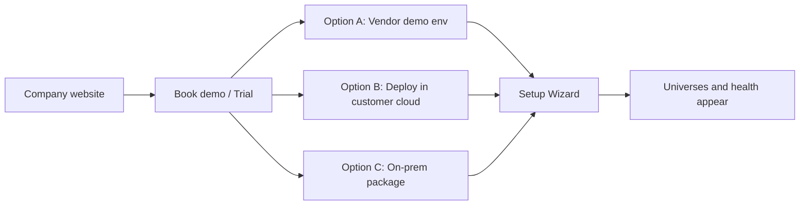

# Yugabyte Platform — Distribution and Customer Onboarding

**Version:** 1.0  
**Last updated:** September 2026  
**Related:** [PRODUCT_MATURITY_AND_GTM.md](./PRODUCT_MATURITY_AND_GTM.md) · [SELF_SERVICE_INTEGRATION.md](./SELF_SERVICE_INTEGRATION.md) · [COMPLETE_PRODUCT_BUILD.md](./COMPLETE_PRODUCT_BUILD.md) · [PRICING_AND_VALUE.md](./PRICING_AND_VALUE.md)

**Principle:** Customer-space first. True multi-tenant SaaS is deferred. Marketplace = deploy into **their** account, not your shared cloud.

---

## 1. Short answer

| Stage | What to do |
|-------|------------|
| **Now (demo + first pilots)** | **Not** multi-tenant SaaS. Ship a **private install** (AMI / Terraform / Helm / Marketplace listing *later*). Demo = your AWS/GCP **demo tenant** (single-tenant box you control). |
| **Sell path** | Website → **Request demo / Start trial** → provision **their** VPC (or they click Deploy) → Setup Wizard (YBA → agents). |
| **Marketplace** | Excellent **distribution**, not a substitute for product. Do it when the install is one-click reliable. |
| **On-prem** | Same product, different package (tarball/air-gap). Same wizard after install. |

**Do not lead with “sign up for SaaS on our shared cloud”** for banks/telco YB buyers. Lead with **“Deploy in your account”** (Marketplace or guided) + optional **we host a private instance for you**.

**Website one-liner (later):**

> Deploy in your AWS, GCP, or data center. Connect YBA in minutes. Agents enroll automatically. Your data never leaves your environment.

---

## 2. Three distribution models

### A — Hosted demo / trial (you run it)

- **You** deploy one (or few) stacks on **your** AWS/GCP.
- Customer gets URL + trial login — for **sales demos**, not production data.
- Use **seed + fake ingest** or a **sandbox YBA** — never their PROD secrets on day 1 of a website click.

**Use for:** Website “Try demo”, sales calls, investors.

### B — Deploy in customer AWS/GCP (recommended product path)

- Customer (or you) deploys **single-tenant** control plane into **their** account.
- Paths:
  1. **Deploy with Terraform / CloudFormation / Helm** from your site (fastest to build).
  2. Later: **AWS / GCP Marketplace** → Subscribe → Launch into their project/account.
- Agents and YBA stay inside their network; outbound HTTPS to *their* control plane.

**Use for:** Real pilots and paid customers. Matches [SELF_SERVICE_INTEGRATION.md](./SELF_SERVICE_INTEGRATION.md).

### C — On-prem / air-gap

- Same binary/UI, packaged as **RHEL tarball** (`yuno-install`).
- Website: **Download** or **Request offline bundle** (NDA / license key).
- Install on VM → same Setup Wizard → Connect YBA / agents (often **Push** mode if no outbound).

**Use for:** Regulated / no-cloud estates.

### Multi-tenant SaaS (deferred)

- Website Sign up → create tenant → agents point at **your** URL.
- Defer until after private installs work and mid-market demand appears.
- Heavy: isolation, SOC2, VPN to their YBA, data residency.

---

## 3. Marketplace vs “SaaS on AWS”

| | **Marketplace listing** | **Your SaaS on AWS/GCP** |
|--|-------------------------|---------------------------|
| What it is | Customer deploys **your AMI/Helm chart into their account** | Customers log into **your** multi-tenant app |
| Data location | Their VPC | Your cloud |
| Enterprise fit | High | Lower for YB banks/telco |
| Your ops | Lower (they run the VM) or you offer managed | You run everything |
| Website CTA | “Deploy from Marketplace” / “Launch in my AWS” | “Sign up” |
| When | After install is boring and documented | After 3–5 private wins + demand |

**Marketplace ≠ SaaS.** Marketplace is usually **bring-your-own-account private deploy** — the right mid-term cloud channel.

---

## 4. Website → customer onboard funnel

1. **Website** — Product story, pricing teaser, security one-pager.  
   CTAs: **Watch demo** | **Start cloud trial** | **Deploy in my AWS/GCP** | **Request on-prem**.

2. **Identity / lead** — Form or Auth0/Clerk → **Customer org** in a lightweight **billing/license plane** (not their YB data).

3. **Choose deploy mode**
   - **Sandbox demo** (your AWS) — instant, fake/safe data.
   - **Customer cloud** — Terraform/Marketplace → `https://yuno.customer.internal`.
   - **On-prem** — License key + download portal.

4. **Activation** — Same **Setup Wizard**: Connect YBA → Deploy agents → Optional integrations.  
   License: phone-home **or** offline license file.

5. **Success** — First universe visible → expand integrations → convert trial → paid.

---

## 5. Local build vs what customers run

| You (now) | Customer (real) |
|-----------|-----------------|
| `npm run dev:mac` / local SQLite | Same app, PostgreSQL, TLS, no `AUTO_SEED` |
| Demo seed for UI | Live YBA + agents |
| Manual curl ingest | Wizard + connectors |
| No website | Website + CRM + license + deploy button |

**Product code is one.** Packaging differs: Mac/dev, Helm/AMI, Marketplace, on-prem tarball.

---

## 6. Recommended sequence

| Horizon | Distribution | Website CTA |
|---------|--------------|-------------|
| **Now – demos** | Your demo stack on **one AWS (or GCP) account** + local Mac | “Book a demo” / passworded demo URL |
| **First 1–3 paying pilots** | Terraform/Helm into **their** AWS/GCP + on-prem tarball | “Start private pilot” (sales-assisted) |
| **Scale** | **AWS Marketplace** (then GCP) + optional Managed Private | “Deploy from Marketplace” |
| **Later** | Multi-tenant SaaS for mid-market only | “Sign up” |

For **product demos today:** run a **single-tenant “SaaS-looking” URL** on AWS/GCP that *you* own. Under the hood: **one customer per stack**. Do not invest in multi-tenant tenancy yet.

---

## 7. On-prem in practice

1. Customer buys / trials → **license + download** (or USB for air-gap).  
2. Run `install.sh` on RHEL.  
3. Open UI on internal HTTPS.  
4. Same wizard: YBA connect / agent one-liner / push tokens.  
5. Updates: signed packages from portal or offline media.

Same product; different **channel**.

---

## 8. Decision summary

| Question | Suggestion |
|----------|------------|
| SaaS on AWS/GCP for demo? | **Yes for demos** — hosted single-tenant. **No as primary production model** yet. |
| Marketplace so they pull & deploy? | **Yes as primary cloud GTM** once install is one-click. |
| On-prem? | Keep **yuno-install**; website “Request offline package.” |
| Website onboard today? | **Demo / contact sales** → later **Deploy** + license. |

**One product, many packages:** local → your demo cloud → customer VPC → Marketplace → on-prem.
