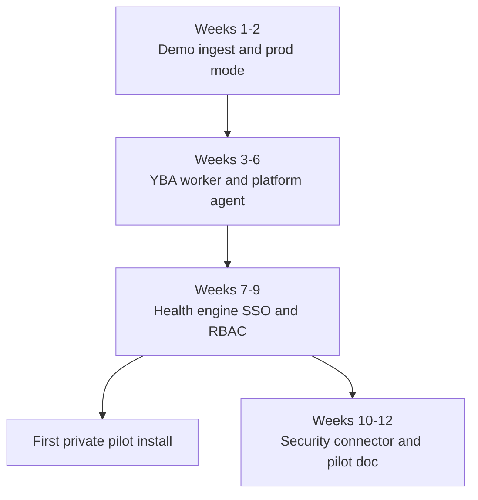
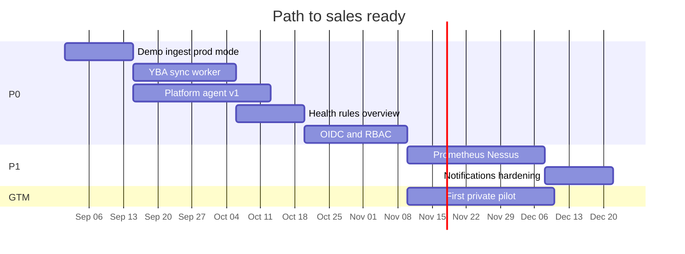

# Yugabyte Platform — Product Maturity, GTM, and Pending Features

**Version:** 1.0  
**Last updated:** August 2026  
**Related:** [PRICING_AND_VALUE.md](./PRICING_AND_VALUE.md) · [SELF_SERVICE_INTEGRATION.md](./SELF_SERVICE_INTEGRATION.md) · [DISTRIBUTION_AND_ONBOARDING.md](./DISTRIBUTION_AND_ONBOARDING.md) · [COMPLETE_PRODUCT_BUILD.md](./COMPLETE_PRODUCT_BUILD.md) · [PRODUCT_TARGET.md](./PRODUCT_TARGET.md) · [GOLDEN_PATH_MILESTONE.md](./GOLDEN_PATH_MILESTONE.md) · [PRODUCTION_SPECIFICATION.md](./PRODUCTION_SPECIFICATION.md) · [BACKEND_DESIGN.md](./BACKEND_DESIGN.md) · [TABLES_AND_APIS.md](./TABLES_AND_APIS.md)

---

## 1. Executive recommendation

**Lead with customer-space deployment first** (install in the buyer’s VPC or on-prem RHEL VM via `yuno-install`). **Do not lead with multi-tenant SaaS** until live integrations and enterprise auth are working.

### Recommended GTM sequence

| Phase | Model | When |
|-------|--------|------|
| **A** | Single-tenant install in customer environment | Now → first paid pilot |
| **B** | Vendor-managed private deploy (you operate; data stays in their AWS/Azure account) | After 2–3 successful installs |
| **C** | True multi-tenant SaaS with self-service onboarding | Optional; mid-market only, after repeat integration patterns |

**Why customer-space first:** The architecture assumes agents and integrations **push data inward** to a metadata store inside the customer boundary. Banks, retailers, and telcos running YugabyteDB at scale typically will not send inventory, CVEs, and finance data to a vendor’s shared SaaS tenant.

---

## 2. Current maturity assessment

### 2.1 Built and credible today

| Area | Status | Evidence |
|------|--------|----------|
| Operations UI | Strong | Overview, Universes, VMs, Agents/Alerts, Finance, Settings |
| REST API + ingest | Real | `backend/src/ingest.js`, `index.js` |
| Metadata store | Real | PostgreSQL (RHEL) / SQLite (Mac) |
| Bootstrap read path | Real | `GET /bootstrap` |
| Finance chargeback | Differentiator | `financeEngine.js`, settings, consumer ingest |
| RHEL offline packaging | Real | `packaging/rhel`, `yuno-install/install.sh` |
| Admin / settings shell | Partial | TLS, LDAP config UI, finance rate card — stored, not fully enforced |

### 2.2 Still MVP (what buyers will notice)

| Gap | Why it feels like MVP |
|-----|------------------------|
| Data from seed, not live pipeline | Mac `AUTO_SEED=true`; no workers push real YBA/Nessus/Prometheus data |
| No platform agent | No agent binary in repo |
| No integration workers | No YBA, Prometheus, Nessus, Tanium, reconciler, cert scanner |
| No health rules engine | Alerts/issues are static JSON |
| Overview KPIs pre-baked | `globalKpis` / `globalOverview` in `app_config`, not computed live |
| RBAC cosmetic | UI role dropdown only; API has no permission checks |
| SSO/LDAP not enforced | Config saved; no OIDC login flow |
| Read APIs open | All `GET` endpoints unauthenticated |
| Provisioning fake | `ProvisionWizard.jsx` uses timers; no backend / Temporal |
| No notifications | No email/Slack/PagerDuty |
| No data provenance | No seed vs ingest labels |
| Bundle drift risk | `yuno-install/bundle/` may lag `backend/src/` |

**Maturity score (honest):** ~**35–40%** of Production Spec for Operations Console; ~**5%** for Self-Service Provisioning.

---

## 3. Deployment models compared

### Option 1 — Install in customer space (recommended first)

**Model:** Tarball or Helm on RHEL/Ubuntu VM or customer AWS/Azure. Integrations call `https://platform.customer.internal/api/v1/ingest/*`.

| Pros | Cons |
|------|------|
| Matches regulated buyer expectations | Slower per-customer install |
| Data never leaves their network | You support OS/patching |
| Aligns with RHEL/air-gap packaging | Harder central updates |
| Agents outbound-only — natural fit | Revenue skews project + support early |

**Best for:** Banks, retail, telco, any “data cannot leave VPC” policy.

---

### Option 2 — Multi-tenant SaaS

**Model:** Vendor-hosted platform; customers onboard; data in shared PostgreSQL with `tenant_id`.

| Pros | Cons |
|------|------|
| Faster onboarding at scale | Enterprise banks/telcos often reject |
| Pure SaaS ARR | Agents must reach your cloud — firewall pain |
| One ops surface | SOC2, pen tests, tenant isolation — 6–12+ months |
| | Per-tenant VPN/private link to their YBA/Nessus |
| | You hold their compliance data (CVEs, certs, audit) |

**Best for:** Mid-market (logistics, SaaS) with lighter compliance.

**When to build:** After 3–5 successful private installs.

---

### Option 3 — Managed private (hybrid)

**Model:** You operate the platform; it runs in **the customer’s** cloud subscription (single-tenant).

| Pros | Cons |
|------|------|
| Feels like SaaS to the buyer | Still one install per customer |
| Data stays in their account | Needs Terraform/IaC per customer |

**Position as:** “Managed Control Plane” between on-prem and SaaS.

---

### Decision matrix

| Criterion | Customer-space | Managed private | Multi-tenant SaaS |
|-----------|----------------|-----------------|-------------------|
| Time to first credible sale | 3–4 months | 4–6 months | 9–15 months |
| Enterprise acceptance | High | High | Low–medium |
| Matches current codebase | High | Medium | Low |
| Recurring revenue potential | Medium | High | Highest |
| Security/compliance burden | Low (customer) | Medium | High (vendor) |

**Verdict:** Build for **customer-space + managed private**. Design APIs to allow `tenant_id` later; **do not operate shared SaaS yet**.

---

## 4. Pending features — build before outreach

**Goal:** **Production Operations Console v1** (not full provisioning). Enough to avoid “pretty seeded dashboard” objections.

### P0 — Must have before sales demos (8–12 weeks)

| # | Feature | Why | Effort |
|---|---------|-----|--------|
| 1 | Live data pipeline | `demo-ingest.sh` or Node feeder → real `/ingest/*` | 1–2 wk |
| 2 | YBA sync worker v1 | Poll YBA → universes/nodes/metrics | 2–3 wk |
| 3 | Platform agent v1 | Heartbeat + VM components + cert scan | 3–4 wk |
| 4 | Health evaluation service | Rules → alerts, universe health/issues | 2 wk |
| 5 | Server-computed overview | SQL aggregation replaces static `app_config` KPIs | 1 wk |
| 6 | OIDC/SSO login | Entra ID/Okta; gate API reads | 2–3 wk |
| 7 | RBAC enforcement | Roles → cloud/env scopes on API | 2 wk |
| 8 | Remove MVP chrome | No demo banner in prod; `AUTO_SEED=false` on RHEL | 3 days |
| 9 | Data provenance labels | `source: seed \| ingest \| yba` in UI | 3 days |
| 10 | Sync install bundle | CI → `yuno-install/bundle`; version in `/health` | 2 days |

**After P0:** Credible pitch — *“Operations Console connected to your YBA and agents.”*

---

### P1 — Paid pilot / production install (next 8–12 weeks)

| # | Feature |
|---|---------|
| 11 | Prometheus metrics worker |
| 12 | Nessus OR Tenable connector |
| 13 | Tanium OR patch API connector |
| 14 | Reconciler v1 (drift) |
| 15 | Notification channels (email/Slack/webhook) |
| 16 | Audit immutability + retention export |
| 17 | Secrets integration (Vault / Secrets Manager) |
| 18 | Metadata DB backup/restore scripts + runbook |
| 19 | Post-install health checklist UI |
| 20 | mTLS for ingest |

---

### P2 — Phase 2 product (3–6 months)

| # | Feature |
|---|---------|
| 21 | Self-service provisioning API + Temporal |
| 22 | PROD approval workflow (real approve/reject) |
| 23 | Lifecycle (upgrade, scale, decommission) |
| 24 | Redis cache for overview at scale |
| 25 | Multi-tenant schema (`tenant_id`) |
| 26 | FinOps (budgets, anomalies, exports) |
| 27 | Auto-remediation (spec Phase 5) |

---

### Explicitly defer (do not block v1 sales)

- Multi-database support beyond YugabyteDB
- Full CMDB replacement
- Kafka event bus (use DB + cron workers first)
- Backend rewrite (Node is fine for v1)
- Multi-tenant SaaS onboarding portal

---

## 5. Phase 1 acceptance criteria (from Production Spec)

| Criterion | Today | After P0 |
|-----------|-------|----------|
| All universes in overview | Demo seed | Live from YBA/agent |
| Cloud → Universe → Node drill-down | UI yes; static data | Live |
| Multi-dimensional universe health | UI yes; not computed | Rules engine |
| Certificate inventory + expiry | Static | Agent + scanner |
| Critical issues feed | Static `app_config` | Computed |
| RBAC enforced | No | Yes |

**Provisioning (Phase 3)** can remain roadmap — sell **Operations + Finance + Compliance** first.

---

## 6. Suggested product SKUs

| SKU | Includes | Defer |
|-----|----------|-------|
| **Yuno Ops Console v1** | Overview, inventory, health, alerts, certs, vulns, patches, drift, audit, finance | Provisioning |
| **Integration pack** | YBA + Agent + Prometheus + one security tool | Second security tool if no license |
| **Managed Private** | Vendor-operated VM in customer cloud | — |
| **Enterprise** | SSO, RBAC, mTLS, HA metadata DB, 7yr audit | Auto-remediation |

**Dollar bands, recurring options, and customer ROI:** see [PRICING_AND_VALUE.md](./PRICING_AND_VALUE.md).  
**Self-service connectors, auto-agent, and push/pull integration:** see [SELF_SERVICE_INTEGRATION.md](./SELF_SERVICE_INTEGRATION.md).  
**Website, Marketplace, on-prem onboarding:** see [DISTRIBUTION_AND_ONBOARDING.md](./DISTRIBUTION_AND_ONBOARDING.md).  
**Full product build checklist (conceptual → physical):** see [COMPLETE_PRODUCT_BUILD.md](./COMPLETE_PRODUCT_BUILD.md).  
**Complete product target (spine + rings + waves):** see [PRODUCT_TARGET.md](./PRODUCT_TARGET.md).  
**Spine build order only:** see [GOLDEN_PATH_MILESTONE.md](./GOLDEN_PATH_MILESTONE.md).

---

## 7. 90-day timeline

### ASCII timeline (always renders)

```
Week 1-2   [ Demo ingest · prod mode polish ]
Week 3-6   [ YBA worker · Platform agent · Health engine ]
Week 7-9   [ OIDC · RBAC ]
Week 10-12 [ Prometheus or Nessus · Pilot install doc ]
Parallel   [ First private pilot after week 9 ]
```

### Mermaid flowchart (render-safe)



### Mermaid gantt (fixed syntax)

Task names avoid `+`, `/`, `(`, `)` and other characters that break parsers.



---

## 8. Outreach guidance

**After P0:** Target Tier-2 Yugabyte adopters (e.g. ComplyAdvantage, Turvo, Scout24) with:

> *“We install the operations control plane in your VPC in two weeks — unified health, security, and chargeback on top of YBA.”*

**Not:** *“Sign up for our SaaS.”*

---

## 9. Bottom line

| Question | Answer |
|----------|--------|
| On-prem vs SaaS? | Customer-space first; managed-private second; SaaS last |
| What removes MVP smell? | Live YBA + agent ingest, computed health/overview, SSO/RBAC, no seed in prod |
| Biggest gaps? | Workers, agent, health engine, auth, provisioning backend, notifications |
| Sell as production today? | No — finish **P0** first (~2–3 months focused work) |
| Sell as vision + pilot? | Yes, with honest roadmap |
