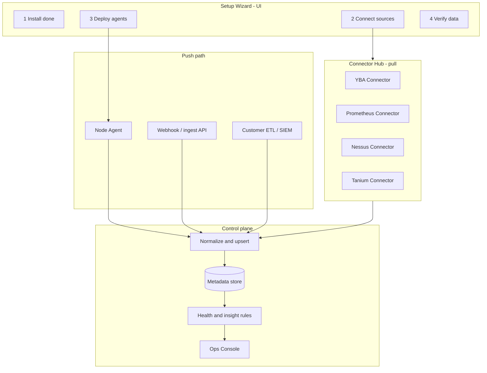

# Yugabyte Platform — Self-Service Integration Architecture

**Version:** 1.0  
**Last updated:** September 2026  
**Goal:** Customers get value in **hours, not weeks** — minimal professional-services lift.  
**Related:** [PRODUCT_MATURITY_AND_GTM.md](./PRODUCT_MATURITY_AND_GTM.md) · [TABLES_AND_APIS.md](./TABLES_AND_APIS.md) · [PRICING_AND_VALUE.md](./PRICING_AND_VALUE.md) · [DISTRIBUTION_AND_ONBOARDING.md](./DISTRIBUTION_AND_ONBOARDING.md) · [COMPLETE_PRODUCT_BUILD.md](./COMPLETE_PRODUCT_BUILD.md)

---

## 1. Executive recommendation

**Do both of your ideas — as a layered, productized system:**

| Mode | When to use | Customer lift |
|------|-------------|----------------|
| **A. Connect (pull)** | Customer pastes credentials for YBA / Prometheus / Nessus / Tanium | Low — form in UI, platform pulls |
| **B. Push (ingest)** | Customer or their tools POST to your APIs (or you give them a one-line agent install) | Lowest for air-gapped / locked-down estates |
| **C. Auto-agent bootstrap** | After YBA (or inventory) is connected, platform **rolls out agents** to discovered nodes | Lowest ongoing; one-time approval for deploy rights |

**Do not promise “fully automatic agent install with zero credentials.”**  
Every enterprise needs *some* trust boundary: YBA API token, SSH/SSM role, or a one-liner they run. The product goal is **one wizard, one token, one click** — not zero human steps.

**Sellable promise:**

> Install the control plane → Connect YBA (5 minutes) → Enable Auto-Agent → Data appears.  
> Optional: Connect security/metrics tools *or* push via webhook/API if you cannot give us pull access.

---

## 2. Target customer journey (zero heavy lift)

```text
Day 0  Install control plane (Helm / tarball / managed private)     ~30–60 min
Day 0  Open UI → Setup Wizard                                      ~5 min
Day 0  Connect YBA (URL + API token) → Test connection             ~5 min
Day 0  Toggle "Deploy agents to discovered nodes"                  ~1 click
       └─ Platform uses YBA / SSM / provided script to bootstrap
Day 0  Heartbeats + inventory fill Overview                        ~minutes
Day 0  Optional: Connect Prometheus / Nessus / Tanium OR
       copy Push endpoint + token into their pipeline              ~10–15 min each
Day 0  Finance rate card (defaults OK; tweak later)                ~2 min
Done   Live fleet view, health, finance; vulns/patches when connected
```

**Success metric:** Time-to-first-universe-in-UI **&lt; 1 hour** after control plane is up.

---

## 3. End-to-end architecture



**Core principle (unchanged):** UI never talks to YBA/Nessus/Tanium directly.  
**Connectors** and **agents** write only through **normalized ingest** (your existing `/api/v1/ingest/*`).

---

## 4. Integration modes (design both; let customer choose per source)

### Mode A — Connect (platform pulls)

**UI:** Settings → **Integrations** → card per source → “Connect” form.

| Field pattern | Example |
|---------------|---------|
| Base URL | `https://yba.corp.internal` |
| Auth | API token / OAuth / client cert |
| Scope | Clouds / environments / tags (optional) |
| Schedule | Every 2–5 min (default) |
| **Test connection** | Required before Save |

**Backend:** Connector worker reads `platform_settings.integrations.<id>`, polls, maps to ingest shape, upserts.

**Best for:** YBA, Prometheus, Tenable/Nessus, Tanium, cloud inventory (AWS/Azure).

### Mode B — Push (customer or agent posts)

**UI:** Integrations card → **Push mode** shows:

- Endpoint URL(s): `POST /api/v1/ingest/vulnerabilities`, etc.
- Scoped token (rotatable)
- Curl / Python / Terraform snippet
- Optional **OpenAPI / schema download**
- Optional **webhook secret** + sample payload

**Best for:** Air-gapped, “we won’t open inbound to Nessus,” custom CMDB, SIEM already exporting CVEs.

### Mode C — Hybrid (recommended default)

1. **YBA = Connect (pull)** → discover universes/nodes  
2. **Agents = Auto-deploy + Push (heartbeat)** → host/process/cert facts  
3. **Security tools = Connect *or* Push** — customer picks  
4. **Finance usage = Connect (YB metrics) *or* Push** (`/ingest/consumer-usage`)

This matches real enterprise constraints and still feels self-service.

---

## 5. Agent strategy (your “auto-install on every node”)

### 5.1 What the agent does (keep it small)

| Collect | Interval | Maps to |
|---------|----------|---------|
| Heartbeat + node identity | 30s | `/ingest/heartbeat` |
| YB process status (master/tserver) | 30s | node `components` |
| Host CPU/mem/disk sample | 1–5 min | metrics / health |
| Local TLS cert expiry | daily | `/ingest/certificates` |
| Agent version | each heartbeat | drift / upgrade |

**Do not** put Nessus scanning inside the agent. Keep security scanners as separate integrations.

### 5.2 How agents get onto nodes (ordered by customer acceptance)

| Rank | Method | Lift | Notes |
|------|--------|------|-------|
| **1 (best)** | **YBA software / GFlags / script hook** after YBA connect | One click after YBA token | Nodes already known via YBA |
| **2** | **One-liner bootstrap** customer runs once per image or via Ansible | Low | `curl -fsSL …/agent-install.sh \| sudo bash -s -- --token … --url …` |
| **3** | **AWS SSM / Azure Run Command** using customer role | Low if IAM exists | Platform triggers; no SSH keys in your DB |
| **4** | **SSH/WinRM with vaulted key** | Medium | Works; many security teams dislike |
| **5** | **Bake into golden image** | Lowest ongoing | Best for greenfield |

**Recommended product default:**  
**YBA-discovered nodes + one-click “Deploy agent”** that:

1. Generates a **node-scoped or fleet install token** (short-lived)  
2. Pushes install via preferred method (YBA custom script / SSM / downloadable Ansible playbook)  
3. Shows per-node status: `Pending → Installing → Connected → Degraded`

### 5.3 Important honesty for sales

“Automatically install agents on each node” requires the customer to grant **one** of: YBA automation rights, SSM/Run Command role, or a bootstrap script in their image pipeline.  
Market it as **Auto-Agent Enrollment**, not magic zero-trust bypass.

---

## 6. Connector Hub (product surface)

Add Settings section: **Integrations** (marketplace-style cards).

| Integration | Default mode | Required to unlock UI area | Fallback |
|-------------|--------------|----------------------------|----------|
| **Yugabyte Anywhere (YBA)** | Connect | Universes, nodes, YBA health | Manual `/ingest/universes` |
| **Platform Agent** | Auto + Push | Host health, certs, components | Manual heartbeat |
| **Prometheus / YBA metrics** | Connect | Metrics panel, finance estimates | Push `/ingest/metrics` |
| **Nessus / Tenable** | Connect or Push | Vulnerabilities | Push CVE JSON |
| **Tanium / patch API** | Connect or Push | Patching | Push patch jobs |
| **Usage / chargeback** | Connect or Push | Finance consumers | Push `/ingest/consumer-usage` |
| **Slack / Email / Webhook out** | Connect | Notifications | Optional |
| **Generic Webhook** | Push | Any future source | Open schema |

Each card shows:

- Status: `Not connected | Connected | Syncing | Error`  
- Last sync time + row counts  
- **Test** / **Sync now** / **Disconnect** / **Rotate token**  
- **Docs snippet** for Push mode  

---

## 7. Universal data contract (easy for “any platform”)

To stay “easily integrated with any platform,” standardize on **three contracts**:

### 7.1 Ingest REST (already started)

Keep `/api/v1/ingest/*` as the **canonical write API**.  
Every connector ends by calling the same upserts — one pipeline, many sources.

### 7.2 Integration descriptor (plug-in model)

```json
{
  "id": "nessus",
  "name": "Nessus / Tenable",
  "modes": ["connect", "push"],
  "configSchema": { "url": "string", "accessKey": "secret", "secretKey": "secret" },
  "mapsTo": ["vulnerabilities", "alerts"],
  "pollMinutes": 360,
  "samplePayloadUrl": "/docs/samples/nessus.json"
}
```

New integrations = new descriptor + mapper, not a UI rewrite.

### 7.3 Optional OpenTelemetry / event envelope (future)

For vendors that already emit OTLP/webhooks:

```json
{
  "source": "custom-siem",
  "type": "vulnerability.upsert",
  "observedAt": "2026-09-07T12:00:00Z",
  "resource": { "universeId": "uni-…", "nodeId": "node-…" },
  "payload": { }
}
```

Single `POST /api/v1/ingest/events` → router → table.  
That’s how you stay open to “any platform” without 50 bespoke UIs.

---

## 8. Setup Wizard (must-have for self-service)

Guided first-run (block empty Overview with this, not a blank demo):

1. **Welcome** — what this platform is (estate ops, not YBA replacement)  
2. **Connectivity check** — TLS, API health, outbound allowed  
3. **Connect YBA** — Test → Sync → show universe count  
4. **Agents** — Enable Auto-deploy **or** copy install one-liner  
5. **Optional integrations** — Prometheus / Security (skip allowed)  
6. **Finance defaults** — Use built-in rate card → Save  
7. **Done** — Checklist: universes N, agents M connected, last sync timestamps  

Persist progress in `platform_settings.setup` (`step`, `completedAt`, `awaitingAgents`).

---

## 9. Security & least privilege (so enterprises say yes)

| Concern | Approach |
|---------|----------|
| Secrets | Store in Vault / Secrets Manager / encrypted `platform_settings`; never in UI logs |
| Tokens | Short-lived install tokens; rotate agent/ingest tokens from UI |
| Network | Agents and connectors are **outbound HTTPS** to control plane (or pull from inside VPC) |
| RBAC | Only Admin can add integrations; Audit every connect/sync/token rotate |
| Blast radius | Per-integration credentials; disconnect = stop poll + revoke push token |
| Air-gap | Push mode + offline agent package in install tarball |

---

## 10. Phased delivery (align with sales “no heavy lift”)

### Phase S0 — Sellable self-service MVP (6–10 weeks)

| Deliverable | Outcome |
|-------------|---------|
| Integrations UI (cards) + settings store | Customer can see “what’s connected” |
| YBA Connect + sync worker | Universes/nodes without manual curl |
| Agent one-liner + `/ingest/heartbeat` | Live host facts |
| Setup Wizard (YBA → agent → verify) | Time-to-value story for demos |
| Push docs + token UI for vulns/metrics/usage | Security teams who won’t allow pull |
| Provenance + last sync | Trust (“this is live”) |

### Phase S1 — Auto-agent enrollment (4–6 weeks)

| Deliverable | Outcome |
|-------------|---------|
| Deploy agents to YBA-discovered nodes (script/SSM/YBA hook) | Your “automatic on each node” promise |
| Agent fleet page (connected / missing / outdated) | Ops clarity |
| Cert scan via agent | Certificates tab live |

### Phase S2 — Connector pack (6–8 weeks)

| Deliverable | Outcome |
|-------------|---------|
| Prometheus Connect | Metrics + finance inputs |
| Nessus **or** Tenable Connect + Push | Vulnerabilities |
| Tanium **or** generic patch Push | Patching |
| Health rules + insight cards | AIOps-lite value |

### Phase S3 — Ecosystem (ongoing)

| Deliverable | Outcome |
|-------------|---------|
| Generic events ingest + OpenAPI | Any platform |
| Terraform / Ansible modules | Infra-as-code customers |
| Helm + “Managed private” one-click | Mid-market scale |
| Partner connectors | Marketplace narrative |

---

## 11. What *not* to do

| Anti-pattern | Why |
|--------------|-----|
| Require professional services for every Nessus field map | Kills self-service pricing |
| Only pull *or* only push | Loses half of enterprise buyers |
| Agent that also runs vulnerability scans | Scope creep; security conflicts |
| Auto-SSH with root keys baked into product | Security review failure |
| Silent seed data after “Connect” | Destroys trust |
| Custom UI per vendor with no shared ingest | Cannot scale to “any platform” |

---

## 12. Competitive analogy (set expectations)

Think like:

- **Datadog / Elastic Agent** — one install path, outbound  
- **Grafana Cloud / Alloy** — connect *or* remote_write (push)  
- **ServiceNow Service Graph** — connectors + import sets  
- **CrowdStrike / Tanium** — enrollment token + fleet dashboard  

Your differentiator remains **Yugabyte-aware estate + FinOps + security correlation**, not “we invented agents.”

---

## 13. Recommended default for sales + product

**Primary path (80% of value, lowest lift):**

1. Customer installs control plane (or you manage private).  
2. Customer pastes **YBA URL + API token** → Sync.  
3. Customer enables **Auto-Agent Deploy** (or runs one-liner once via their automation).  
4. Overview fills.  
5. For vulns/pricing/metrics: either **Connect** (credentials) **or** **Push** (token + sample).  

**Secondary path (locked-down):**  
YBA optional; customer pushes inventory + usage + CVEs via ingest/webhooks only.

---

## 14. Bottom line

| Your idea | Verdict |
|-----------|---------|
| Auto-install agents on each node | **Yes** — after discovery (YBA), via enrollment token + YBA/SSM/script; show fleet status |
| Connection details per integration | **Yes** — Connect (pull) cards with Test + schedule |
| Mechanism for customer to push data | **Yes** — first-class Push mode, tokens, samples, OpenAPI |
| Seamless + any platform | **Yes** — all paths normalize to `/ingest/*` + pluggable descriptors |

**Self-service = Wizard + Connector Hub + Auto-Agent + Push fallback.**  
Professional services become optional hardening, not the path to first value.

---

## 15. Next implementation step (when ready to build)

1. `platform_settings.integrations` schema + Admin APIs  
2. Settings UI → **Integrations** section + Setup Wizard shell  
3. YBA connector worker → existing ingest endpoints  
4. Agent install script + fleet status API  
5. Push token management UI for metrics / vulns / consumer-usage  

That sequence turns the current “curl + seed” product into a **self-serve integration platform** you can sell without heavy lift.
