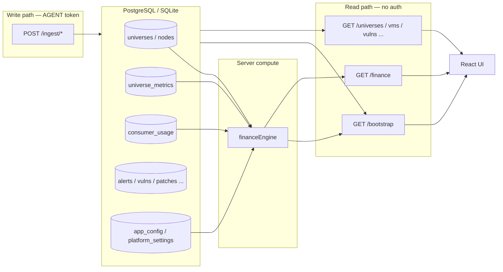

# Yugabyte Platform — Tables, APIs, and Integration Examples

**Version:** 1.0.0  
**Base URL (Mac dev):** `http://localhost:3001/api/v1`  
**Related:** [API_REFERENCE.md](../yuno-install/docs/API_REFERENCE.md) · [BACKEND_DESIGN.md](./BACKEND_DESIGN.md)

This document maps every PostgreSQL/SQLite table to its read and write APIs, explains storage patterns, and provides **one example payload + curl command per integration**.

---

## 1. Authentication

| Audience | Header | Used for |
|----------|--------|----------|
| **Agents / integrations** | `Authorization: Bearer <AGENT_API_TOKEN>` | All `POST /ingest/*` and `DELETE /ingest/*` |
| **Administrators** | `Authorization: Bearer <ADMIN_API_TOKEN>` | `/admin/*`, finance settings, reseed |
| **UI / read clients** | None (today) | All `GET` endpoints |

Alternative: `X-API-Key: <token>`

Mac dev tokens (`packaging/mac/config/secrets.env`):

```bash
export BASE="http://localhost:3001/api/v1"
export AGENT_TOKEN="dev-agent-token"
export ADMIN_TOKEN="dev-admin-token"
```

Production tokens live in `/etc/yuno/secrets.env`.

---

## 2. Storage patterns

| Pattern | Tables | How it works |
|---------|--------|--------------|
| **Structured columns** | `universes`, `nodes`, `universe_metrics`, `consumer_usage` | SQL columns + JSON for nested fields (`health_json`, `vm_json`, `metrics_json`) |
| **Document blob** | `alerts`, `drift_items`, `vulnerabilities`, `patch_jobs`, `certificates`, `infrastructure`, `audit_log`, `platform_health` | Full UI object in `payload_json` (upsert by `id`) |
| **Key-value config** | `app_config`, `platform_settings` | One JSON document per `key` |
| **Computed (not stored)** | Finance outputs | `universeCosts`, `consumerCosts`, `financeKpis` built at read time from tables + policy |

**Mental model:** Integrations write **facts**; the API **aggregates** on read; the UI **renders** and applies filters.

---

## 3. Master table → API map

| Table | Primary keys | Typical source | Read APIs | Write APIs | UI screens |
|-------|--------------|----------------|-----------|------------|------------|
| **`universes`** | `id` | YBA sync | `GET /bootstrap`, `GET /universes?cloud=&environment=` | `POST /ingest/universes` | Overview, Universes |
| **`nodes`** | `id` → `universe_id` | Agent, YBA | `GET /bootstrap` (`nodesByUniverse`) | `POST /ingest/nodes`, `POST /ingest/heartbeat` | Universe detail |
| **`universe_metrics`** | `universe_id` | Prometheus aggregator | `GET /bootstrap`, `GET /finance` | `POST /ingest/metrics` | Universe metrics |
| **`infrastructure`** | `id` | Agent (VM inventory) | `GET /vms?cloud=&environment=&agentStatus=` | `POST /ingest/infrastructure`, `POST /ingest/heartbeat` | VMs tab |
| **`consumer_usage`** | `id`, unique `(universe_id, database_name)` | Usage/chargeback job | `GET /bootstrap`, `GET /finance` | `POST /ingest/consumer-usage`, `DELETE /ingest/consumer-usage/:universeId/:database` | Finance |
| **`alerts`** | `id` | Health rules, workers | `GET /alerts` | `POST /ingest/alerts`, `DELETE /ingest/alerts/:id` | Agents & Alerts → Alerts |
| **`drift_items`** | `id` | Reconciler | `GET /drift` | `POST /ingest/drift` | Agents & Alerts → Drift |
| **`vulnerabilities`** | `id` | Nessus worker | `GET /vulnerabilities?cloud=&environment=&severity=&status=` | `POST /ingest/vulnerabilities` | Vulnerabilities |
| **`patch_jobs`** | `id` | Tanium worker | `GET /patch-jobs?cloud=&environment=&status=` | `POST /ingest/patch-jobs` | Patching |
| **`certificates`** | `id` | Cert scanner | `GET /certificates` | `POST /ingest/certificates` | Certificates |
| **`audit_log`** | `id`, sorted by `sort_time` | Auto on ingest | `GET /audit` | Written automatically by ingest |
| **`platform_health`** | `id` (serial) | Install, probes | `GET /platform/health` | Seed/install only (today) | Settings → Platform health |
| **`app_config`** | `key` | Seed, future aggregators | `GET /bootstrap`, `GET /overview/*` | No public ingest yet | Overview KPIs |
| **`platform_settings`** | `key` | Install, Settings UI | `GET /settings` | `PUT /admin/settings/*` | Settings tabs |
| **`schema_migrations`** | `version` | Install script | — | Install only | — |

Schema source: `yuno-install/migrations/001_schema.sql`, `004_consumer_usage.sql`  
Route implementation: `backend/src/index.js`, `ingest.js`, `admin.js`, `bootstrap.js`

---

## 4. Structured table columns

### `universes`

```
id, name, cloud, environment, region, yb_version, owner, status
health_json, issues_json, node_names_json
```

### `nodes`

```
id, universe_id (FK), name, private_ip, public_ip, az, role, status
vm_json, components_json
```

### `universe_metrics`

```
universe_id (PK/FK), metrics_json    ← one snapshot per universe
```

### `consumer_usage`

```
id, universe_id, database_name, consumer, owner
raw_usage_pct, usage_json, trend_pct, updated_at
UNIQUE(universe_id, database_name)
```

---

## 5. Config tables

### `app_config` keys

| Key | Read endpoint | Purpose |
|-----|---------------|---------|
| `companyName` | `/bootstrap` | Tenant label |
| `clouds`, `environments` | `/bootstrap` | Filter dropdowns |
| `globalOverview` | `/overview/matrix` | Cloud × environment matrix |
| `globalKpis` | `/overview/kpis` | Top-level KPI cards |
| `criticalIssues` | `/overview/issues` | Critical issues feed |
| `status`, `vulnStatus`, `patchStatus` | `/bootstrap` | Enum labels |
| `vmAgentDefinitions`, `provisionSteps`, `ybVersions`, `vmSizes`, `regions` | `/bootstrap` | Provisioning UI metadata |

### `platform_settings` keys

| Key | Read | Write |
|-----|------|-------|
| `auth` | `GET /settings`, `GET /admin/settings/auth` | `PUT /admin/settings/auth` |
| `finance` | `GET /settings`, `GET /admin/settings/finance`, drives `/finance` | `PUT /admin/settings/finance` |
| `install` | `GET /settings` | Set at install |
| `tls` | `GET /settings` | `POST /admin/tls` |

---

## 6. Read APIs (no auth today)

| Endpoint | Source tables | Notes |
|----------|---------------|-------|
| `GET /health` | DB ping | Liveness + driver info |
| `GET /bootstrap` | All tables + computed finance | Single payload for UI init |
| `GET /finance` | `universes`, `nodes`, `universe_metrics`, `consumer_usage`, `platform_settings.finance` | Finance-only slice |
| `GET /overview/kpis` | `app_config.globalKpis` | Pre-aggregated |
| `GET /overview/matrix` | `app_config.globalOverview` | Pre-aggregated |
| `GET /overview/issues` | `app_config.criticalIssues` | Pre-aggregated |
| `GET /universes` | `universes` | Optional `cloud`, `environment` |
| `GET /vms` | `infrastructure` | Returns `items` + agent `summary` |
| `GET /alerts` | `alerts` | Raw array |
| `GET /drift` | `drift_items` | Raw array |
| `GET /vulnerabilities` | `vulnerabilities` | `items` + status `summary` |
| `GET /patch-jobs` | `patch_jobs` | `items` + status `summary` |
| `GET /certificates` | `certificates` | Raw array |
| `GET /audit` | `audit_log` | Newest first |
| `GET /platform/health` | `platform_health` | Control-plane status |
| `GET /settings` | `platform_settings` | All settings keys |

**Example — load full UI bootstrap:**

```bash
curl -s "$BASE/bootstrap" | jq '.universes | length'
```

**Example — finance snapshot:**

```bash
curl -s "$BASE/finance" | jq '{kpis: .financeKpis, universes: (.universeCosts | length)}'
```

---

## 7. Computed finance (no dedicated table)

`GET /bootstrap` and `GET /finance` join:

```
universes + nodes + universe_metrics + consumer_usage + platform_settings.finance
                              ↓
                    financeEngine.buildFinancePayload()
                              ↓
              universeCosts | consumerCosts | financeKpis
```

Universe monthly cost is derived from the rate card + node topology + metrics — not stored as rows. Consumer chargeback uses **Model B**: `rawUsagePct` is share of universe capacity (not normalized to 100%).

---

## 8. Integration examples (one curl per integration)

Run integrations in this order on a fresh database:

1. **YBA** — register universe (required before heartbeat)
2. **Agent** — heartbeat (nodes + optional VM record)
3. **Prometheus** — metrics snapshot
4. **Nessus / Tanium / Cert scanner / Reconciler / Health rules / Usage** — independent upserts

---

### 8.1 YBA sync → `universes` (+ optional `nodes`)

**Integration:** Yugabyte Anywhere (YBA) inventory sync worker  
**Endpoint:** `POST /ingest/universes`  
**Table:** `universes`

```bash
curl -s -X POST "$BASE/ingest/universes" \
  -H "Authorization: Bearer $AGENT_TOKEN" \
  -H "Content-Type: application/json" \
  -d '{
    "id": "uni-payments-prod",
    "name": "payments-prod",
    "cloud": "AWS",
    "environment": "PROD",
    "region": "us-east-1",
    "ybVersion": "2.25.1.0",
    "owner": "DBA Team",
    "status": "WARNING",
    "health": {
      "infrastructure": "HEALTHY",
      "yugabytedb": "HEALTHY",
      "yba": "HEALTHY",
      "security": "WARNING",
      "certificates": "CRITICAL"
    },
    "issues": [
      { "severity": "CRITICAL", "message": "Certificate expires in 9 days (node-03 YB TLS)" }
    ],
    "nodes": ["node-01", "node-02", "node-03"]
  }'
```

Optional node upsert (same worker, separate call):

```bash
curl -s -X POST "$BASE/ingest/nodes" \
  -H "Authorization: Bearer $AGENT_TOKEN" \
  -H "Content-Type: application/json" \
  -d '{
    "universeId": "uni-payments-prod",
    "node": {
      "id": "node-payments-prod-01",
      "name": "node-01",
      "privateIp": "10.0.1.11",
      "az": "us-east-1a",
      "role": "MASTER_TSERVER",
      "status": "HEALTHY",
      "vm": { "instanceId": "i-0a1b2c3d4e5f6g7h8", "type": "m5.2xlarge", "os": "RHEL 8.8" },
      "components": [
        { "type": "YB_MASTER", "status": "HEALTHY", "version": "2.25.1.0" },
        { "type": "PLATFORM_AGENT", "status": "HEALTHY", "version": "1.2.0" }
      ]
    }
  }'
```

---

### 8.2 Platform agent → `nodes`, `infrastructure`

**Integration:** Platform agent (30s heartbeat)  
**Endpoint:** `POST /ingest/heartbeat`  
**Tables:** `nodes`, optionally `infrastructure`

Requires universe to exist first (404 if unknown).

```bash
curl -s -X POST "$BASE/ingest/heartbeat" \
  -H "Authorization: Bearer $AGENT_TOKEN" \
  -H "Content-Type: application/json" \
  -d '{
    "universeId": "uni-payments-prod",
    "node": {
      "id": "node-payments-prod-01",
      "name": "node-01",
      "privateIp": "10.0.1.11",
      "publicIp": "—",
      "az": "us-east-1a",
      "role": "MASTER_TSERVER",
      "status": "HEALTHY",
      "vm": { "instanceId": "i-0a1b2c3d4e5f6g7h8", "type": "m5.2xlarge", "os": "RHEL 8.8" },
      "components": [
        { "type": "PLATFORM_AGENT", "status": "HEALTHY", "version": "1.2.0", "message": "Connected" }
      ],
      "infrastructure": {
        "id": "vm-node-payments-prod-01",
        "cloud": "AWS",
        "environment": "PROD",
        "universe": "payments-prod",
        "universeId": "uni-payments-prod",
        "agentStatus": "CONNECTED",
        "lastHeartbeat": "30s ago"
      }
    }
  }'
```

Standalone VM record (without heartbeat):

```bash
curl -s -X POST "$BASE/ingest/infrastructure" \
  -H "Authorization: Bearer $AGENT_TOKEN" \
  -H "Content-Type: application/json" \
  -d '{
    "id": "vm-node-payments-prod-02",
    "universeId": "uni-payments-prod",
    "name": "node-02",
    "cloud": "AWS",
    "environment": "PROD",
    "universe": "payments-prod",
    "agentStatus": "CONNECTED",
    "lastHeartbeat": "45s ago"
  }'
```

**Read back:** `GET /vms?cloud=AWS&environment=PROD&agentStatus=CONNECTED`

---

### 8.3 Prometheus aggregator → `universe_metrics`

**Integration:** Prometheus / YBA metrics aggregator (every 1–5 min)  
**Endpoint:** `POST /ingest/metrics`  
**Table:** `universe_metrics`

```bash
curl -s -X POST "$BASE/ingest/metrics" \
  -H "Authorization: Bearer $AGENT_TOKEN" \
  -H "Content-Type: application/json" \
  -d '{
    "universeId": "uni-payments-prod",
    "metrics": {
      "readOpsPerSec": 18400,
      "writeOpsPerSec": 9200,
      "avgReadLatencyMs": 2.4,
      "avgWriteLatencyMs": 5.1,
      "activeConnections": 412,
      "tabletsTotal": 1024,
      "tabletsUnhealthy": 0,
      "cpuAvgPct": 48,
      "memoryAvgPct": 71,
      "diskUsedPct": 58,
      "replicationLagMs": 18
    }
  }'
```

Used by finance engine for storage/network estimates and metrics panels.

---

### 8.4 Nessus worker → `vulnerabilities`

**Integration:** Nessus / Tenable CVE export  
**Endpoint:** `POST /ingest/vulnerabilities`  
**Table:** `vulnerabilities`

Accepts a **single object or array**. Include `cloud`, `environment`, `universeId` for UI filters.

```bash
curl -s -X POST "$BASE/ingest/vulnerabilities" \
  -H "Authorization: Bearer $AGENT_TOKEN" \
  -H "Content-Type: application/json" \
  -d '[
    {
      "id": "vuln-1",
      "cveId": "CVE-2024-6119",
      "severity": "CRITICAL",
      "title": "OpenSSL X.509 name check buffer overflow",
      "package": "openssl",
      "installedVersion": "1.1.1k",
      "fixedVersion": "1.1.1w",
      "cloud": "AWS",
      "environment": "PROD",
      "universe": "analytics-prod",
      "universeId": "uni-analytics-prod",
      "node": "node-01",
      "nodeId": "node-analytics-prod-01",
      "status": "OPEN",
      "source": "Nessus",
      "firstSeen": "2026-08-18T04:12:00Z",
      "lastSeen": "2026-08-27T06:00:00Z",
      "patchJobId": "patch-1"
    }
  ]'
```

**Read back:** `GET /vulnerabilities?cloud=AWS&environment=PROD&severity=CRITICAL`

---

### 8.5 Tanium worker → `patch_jobs`

**Integration:** Tanium patch deployment sync  
**Endpoint:** `POST /ingest/patch-jobs`  
**Table:** `patch_jobs`

```bash
curl -s -X POST "$BASE/ingest/patch-jobs" \
  -H "Authorization: Bearer $AGENT_TOKEN" \
  -H "Content-Type: application/json" \
  -d '{
    "id": "patch-1",
    "title": "RHEL 8 security bundle — analytics-prod node-01",
    "cveIds": ["CVE-2024-6119", "CVE-2024-37371"],
    "cloud": "AWS",
    "environment": "PROD",
    "universe": "analytics-prod",
    "universeId": "uni-analytics-prod",
    "nodes": ["node-01"],
    "status": "IN_PROGRESS",
    "tool": "Tanium",
    "scheduledFor": "2026-08-27T22:00:00Z",
    "startedAt": "2026-08-27T14:00:00Z",
    "owner": "Security Ops",
    "maintenanceWindow": "PROD-SAT-02:00",
    "progress": 62
  }'
```

**Read back:** `GET /patch-jobs?status=IN_PROGRESS`

---

### 8.6 Cert scanner → `certificates`

**Integration:** Certificate inventory scanner (agent + PKI)  
**Endpoint:** `POST /ingest/certificates`  
**Table:** `certificates`

```bash
curl -s -X POST "$BASE/ingest/certificates" \
  -H "Authorization: Bearer $AGENT_TOKEN" \
  -H "Content-Type: application/json" \
  -d '{
    "id": "cert-1",
    "universe": "payments-prod",
    "type": "YB TLS",
    "location": "node-03",
    "issuer": "Internal CA",
    "expires": "2026-09-05",
    "daysRemaining": 9,
    "status": "CRITICAL",
    "owner": "DBA Team",
    "cloud": "AWS",
    "env": "PROD"
  }'
```

**Read back:** `GET /certificates`

---

### 8.7 Reconciler → `drift_items`

**Integration:** Desired-vs-actual reconciler (every ~5 min)  
**Endpoint:** `POST /ingest/drift`  
**Table:** `drift_items`

```bash
curl -s -X POST "$BASE/ingest/drift" \
  -H "Authorization: Bearer $AGENT_TOKEN" \
  -H "Content-Type: application/json" \
  -d '{
    "id": "drift-1",
    "resource": "prod-yb-03 (analytics-prod/node-01)",
    "component": "Security Agent",
    "desired": "RUNNING",
    "actual": "STOPPED",
    "detected": "2026-08-27T09:06:00Z",
    "universeId": "uni-analytics-prod"
  }'
```

**Read back:** `GET /drift`

---

### 8.8 Health rules engine → `alerts`

**Integration:** Alert evaluation worker (from heartbeats, metrics, cert scans)  
**Endpoint:** `POST /ingest/alerts`  
**Table:** `alerts`

```bash
curl -s -X POST "$BASE/ingest/alerts" \
  -H "Authorization: Bearer $AGENT_TOKEN" \
  -H "Content-Type: application/json" \
  -d '{
    "id": "alert-1",
    "severity": "CRITICAL",
    "title": "Certificate expiring soon",
    "resource": "payments-prod / node-03",
    "message": "YB TLS certificate expires in 9 days",
    "time": "2026-08-27T10:15:00Z",
    "universeId": "uni-payments-prod"
  }'
```

Resolve alert:

```bash
curl -s -X DELETE "$BASE/ingest/alerts/alert-1" \
  -H "Authorization: Bearer $AGENT_TOKEN"
```

**Read back:** `GET /alerts`

---

### 8.9 Usage / chargeback job → `consumer_usage`

**Integration:** Database usage collector (YB metrics + catalog)  
**Endpoint:** `POST /ingest/consumer-usage`  
**Table:** `consumer_usage`

Requires universe to exist. `rawUsagePct` = share of **universe capacity** (Model B).

```bash
curl -s -X POST "$BASE/ingest/consumer-usage" \
  -H "Authorization: Bearer $AGENT_TOKEN" \
  -H "Content-Type: application/json" \
  -d '{
    "universeId": "uni-payments-prod",
    "consumers": [
      {
        "database": "payments_core",
        "consumer": "Payments Core Team",
        "owner": "payments-core@corp.com",
        "rawUsagePct": 5,
        "usage": { "cpuPct": 5, "storageGb": 820, "readOpsPct": 6, "writeOpsPct": 4 },
        "trendPct": 5.1
      },
      {
        "database": "payments_ledger",
        "consumer": "Finance Ledger",
        "owner": "finance-ledger@corp.com",
        "rawUsagePct": 20,
        "usage": { "cpuPct": 20, "storageGb": 610, "readOpsPct": 22, "writeOpsPct": 18 },
        "trendPct": 3.8
      }
    ]
  }'
```

Remove a consumer:

```bash
curl -s -X DELETE "$BASE/ingest/consumer-usage/uni-payments-prod/payments_core" \
  -H "Authorization: Bearer $AGENT_TOKEN"
```

**Read back:** `GET /finance` → `consumerCosts`, `financeKpis`

---

## 9. Admin APIs

All require `ADMIN_API_TOKEN`.

### Finance rate card

```bash
# Read
curl -s "$BASE/admin/settings/finance" \
  -H "Authorization: Bearer $ADMIN_TOKEN" | jq .

# Update (partial merge with defaults)
curl -s -X PUT "$BASE/admin/settings/finance" \
  -H "Authorization: Bearer $ADMIN_TOKEN" \
  -H "Content-Type: application/json" \
  -d '{
    "currency": "USD",
    "allocationModel": "usage_plus_idle",
    "rates": { "computePerVcpuHour": 0.064, "licensePerVcpuMonth": 33.33 }
  }'
```

### LDAP / SSO

```bash
curl -s -X PUT "$BASE/admin/settings/auth" \
  -H "Authorization: Bearer $ADMIN_TOKEN" \
  -H "Content-Type: application/json" \
  -d '{
    "ldapEnabled": true,
    "ssoEnabled": false,
    "provider": "ldap",
    "ldapUrl": "ldaps://ldap.corp.com:636",
    "baseDn": "dc=corp,dc=com"
  }'
```

### Demo reseed (lab only)

```bash
curl -s -X POST "$BASE/admin/reseed" \
  -H "Authorization: Bearer $ADMIN_TOKEN"
```

---

## 10. Audit trail

Every ingest write appends to **`audit_log`** automatically. You do not POST audit entries directly.

```bash
curl -s "$BASE/audit" | jq '.[0:3]'
```

Example auto-generated entry shape:

```json
{
  "id": "audit-1693...",
  "time": "2026-08-28T05:30:00.000Z",
  "actor": "agent",
  "action": "UPSERT",
  "resourceType": "VULNERABILITY",
  "resourceId": "vuln-1",
  "detail": "UPSERT VULNERABILITY vuln-1"
}
```

---

## 11. End-to-end data flow



---

## 12. Quick reference — integration → table → endpoint

| Integration | Table(s) | Endpoint |
|-------------|----------|----------|
| YBA sync | `universes`, `nodes` | `POST /ingest/universes`, `POST /ingest/nodes` |
| Platform agent | `nodes`, `infrastructure` | `POST /ingest/heartbeat` |
| Prometheus | `universe_metrics` | `POST /ingest/metrics` |
| Nessus | `vulnerabilities` | `POST /ingest/vulnerabilities` |
| Tanium | `patch_jobs` | `POST /ingest/patch-jobs` |
| Cert scanner | `certificates` | `POST /ingest/certificates` |
| Reconciler | `drift_items` | `POST /ingest/drift` |
| Health rules | `alerts` | `POST /ingest/alerts` |
| Usage / chargeback | `consumer_usage` | `POST /ingest/consumer-usage` |
| All ingest | `audit_log` | Automatic |

---

## 13. Upsert semantics

- Repeated POSTs with the same `id` (or `universe_id` for metrics) **update** the existing row.
- JSON blob tables store the **entire payload** — send the full object on each upsert.
- Finance outputs refresh on the next `GET /bootstrap` or `GET /finance` after any relevant ingest or settings change.

---

## 14. See also

- Full endpoint specs and error codes: [yuno-install/docs/API_REFERENCE.md](../yuno-install/docs/API_REFERENCE.md)
- Architecture and worker schedule: [docs/BACKEND_DESIGN.md](./BACKEND_DESIGN.md)
- Demo source payloads: [frontend/src/services/demoData.js](../frontend/src/services/demoData.js)
- Machine-readable manifest: [yuno-install/config/schema-manifest.json](../yuno-install/config/schema-manifest.json)
